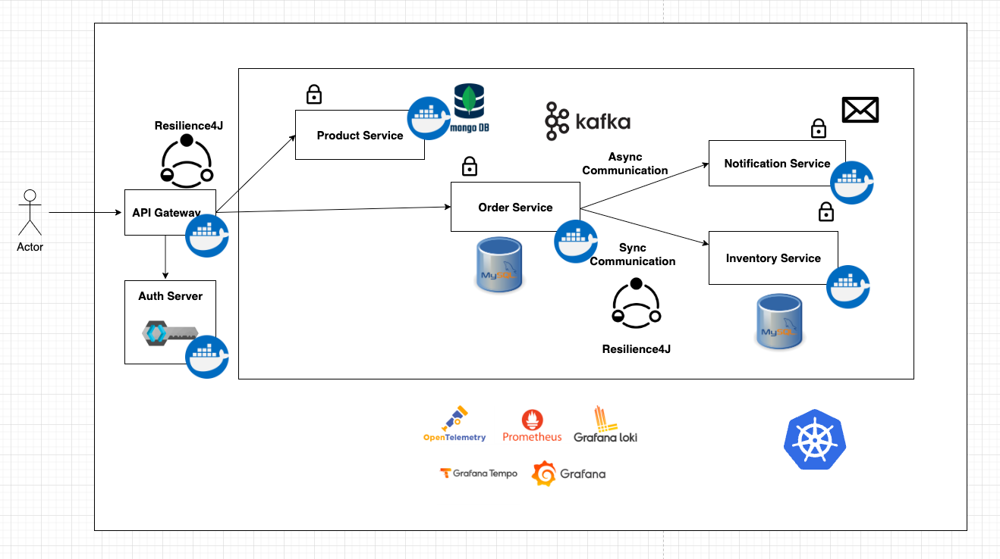

# Spring microservices on Kubernetes — laptop setup

An e-commerce style Spring Boot 3 microservices system running on **Docker Desktop Kubernetes** on a Windows laptop,
with images served from a local **Harbor** registry. The repo is laid out GitOps-style so **Argo CD** can take over
deployments in the next phase.



## Services
| Service | Port | Backing store / integration |
|---|---|---|
| api-gateway (Spring Cloud Gateway MVC) | 9000 | Keycloak (OAuth2 JWT) |
| product-service | 8080 | MongoDB |
| order-service | 8081 | MySQL, Kafka (Avro + Schema Registry), calls inventory-service |
| inventory-service | 8082 | MySQL (Flyway) |
| notification-service | 8083 | Kafka consumer |
| frontend (Angular) | 80 | via api-gateway |

Observability: Prometheus, Grafana, Loki, Tempo.

## Repository layout
```
.
├── pom.xml                         # Maven parent (Java 21, Spring Boot 3.2)
├── services/                       # application source code
│   ├── Dockerfile                  # shared multi-stage build for every Spring service
│   ├── api-gateway/  product-service/  order-service/  inventory-service/  notification-service/
│   └── frontend/                   # Angular app (own Dockerfile)
├── k8s/                            # everything Kubernetes — this is what Argo CD will sync
│   ├── infrastructure/             # MySQL, MongoDB, Kafka, Schema Registry, Keycloak, Grafana stack (kustomize)
│   ├── apps/
│   │   ├── base/                   # environment-neutral Deployments/Services/ConfigMaps
│   │   └── overlays/local/         # laptop: images -> localhost:30002 (Harbor), tags pinned here
│   └── platform/harbor/            # Helm values for the Harbor registry
├── argocd/                         # GitOps (next phase): app-of-apps, AppProject, Applications
├── scripts/windows/                # install-harbor, build-and-push, deploy (PowerShell)
├── local-dev/                      # docker-compose alternative for running without Kubernetes
└── docs/                           # setup notes and troubleshooting
```

## Prerequisites (Windows)
- Docker Desktop with Kubernetes enabled, **cluster type: Kubeadm** (Settings → Kubernetes)
- ~10 GB memory for Docker Desktop (WSL2: set in `%UserProfile%\.wslconfig`)
- `kubectl` (ships with Docker Desktop), `helm` (`winget install Helm.Helm`), `git`
- No local JDK/Maven/Node needed — builds run inside Docker

## Quick start
```powershell
# 1. Registry
powershell -ExecutionPolicy Bypass -File scripts\windows\install-harbor.ps1
# 2. Build all images and push to Harbor (localhost:30002/microservices/*)
powershell -ExecutionPolicy Bypass -File scripts\windows\build-and-push.ps1 -Tag 1.0
# 3. Deploy infrastructure + apps
powershell -ExecutionPolicy Bypass -File scripts\windows\deploy.ps1
```
Or with plain kubectl: `kubectl apply -k k8s/infrastructure` then `kubectl apply -k k8s/apps/overlays/local`.

Access:
- Harbor: http://localhost:30002 (admin / Harbor12345 — local default)
- API gateway: `kubectl port-forward svc/api-gateway 9000:9000` → http://localhost:9000/swagger-ui.html
- Keycloak: `kubectl port-forward svc/keycloak 8080:8080` (admin / admin)
- Grafana: `kubectl port-forward svc/grafana 3000:3000`

## Releasing a new version (today → with Argo CD)
1. `build-and-push.ps1 -Tag 1.1`
2. Change `newTag` for the service in `k8s/apps/overlays/local/kustomization.yaml`, commit, push.
3. Today: run `deploy.ps1`. With Argo CD: it syncs the commit automatically — see [argocd/README.md](argocd/README.md).

## Credits
Application code is based on the open-source
[Spring Boot 3 Microservices course](https://github.com/SaiUpadhyayula/spring-boot-3-microservices-course) by Sai Upadhyayula.
This repo adds the laptop Kubernetes setup, Harbor registry, x86 image builds and the GitOps layout.
See [docs/laptop-setup.md](docs/laptop-setup.md) for what was changed and why.
